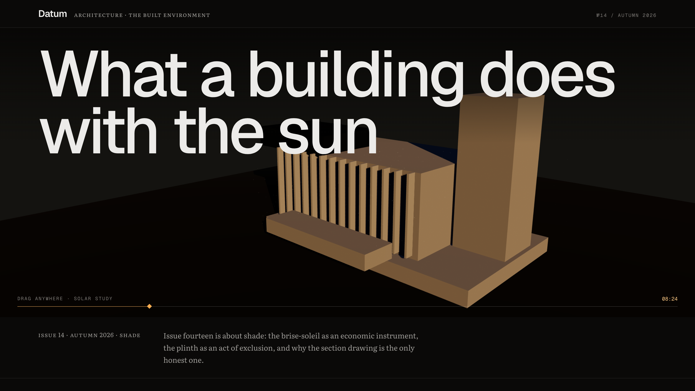
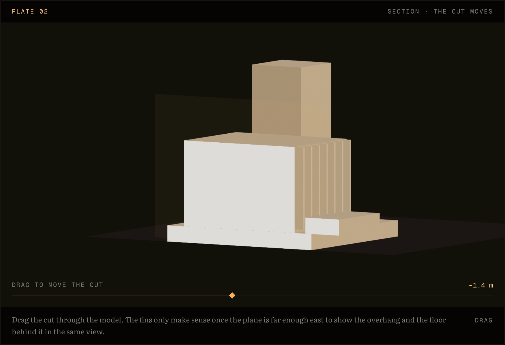

# Datum

An architecture journal where the drawings are live and the numbers are not typed.

Five essays about the parts of a building nobody publishes — the depth of a sun screen, the height of a plinth, the week a decision was actually taken. Eleven plates: a solar study you drag the sun across, a section whose cutting plane you move, a level schedule that re-bases on any line you press, and a 1:50 model you can stand on your own desk in AR.

**Live:** <https://datum-journal-62n.pages.dev>





---

## The one idea

Every measured quantity on the site is derived from a single array — the building, written as data in [`src/lib/massing.ts`](src/lib/massing.ts). The cover render, the elevation, the section, the AR model, the dimension chains and **the numbers inside the prose** all read from it.

```ts
// src/data/bodies.ts — the copy
"The fins … are {{finDepth}} deep and spaced at {{finPitch}} centres."
```

`{{finDepth}}` resolves at build time and throws on an unknown key, so a typo fails the build rather than shipping. The suite also fails if a quantity is ever spelled out in digits anywhere in the copy.

This is not decoration. The article used to claim the fins were *140 millimetres deep* against a model that projects **520** — and it was wrong for exactly as long as it was a string. Three more drifts turned up once the mechanism was in place: the building's overall width was computed from two volumes that only looked like the extremes and read 15,250 against a true 17,050; the cantilever's "3.1 m overhang" was true on no axis at all; and the sun rose in the west on a cover whose subject is what a south elevation does with the sun.

## What is on the site

| | |
| --- | --- |
| Articles | 5, about 4,200 words |
| Plates | 11 — six of them interactive |
| Block types | 12, so prose is never the only option |
| AR model | 1:50, 341 × 190 × 224 mm, 19 parts, generated at build time |
| Tests | 24 Vitest |
| Browser checks | 5 Playwright suites, six pages × three widths |

Every interactive plate is reachable in one Tab and driven with arrow keys, Page, Home and End. The page makes **zero requests off its own origin** — no CDN, no font service, no analytics.

## Things worth opening the code for

**The AR is generated, not exported.** [`scripts/build-ar.mjs`](scripts/build-ar.mjs) runs on `prebuild` and writes USDZ and GLB straight from `MASSING`. `USDZExporter` needs no DOM; `GLTFExporter` asks for `FileReader`, which Node lacks, so a small shim over `Blob` stands in. iOS gets `<a rel="ar">` and native Quick Look with no JavaScript and the scale pinned; Android gets a Scene Viewer intent; desktop gets a QR encoded at build time into flat SVG rectangles. The trigger is an axonometric drawn from the same array — Quick Look will only launch from an anchor holding exactly one ``, so the button had to be a picture, and in this journal a picture is a drawing.

**The axonometric resolves hidden surfaces exactly.** Sorting faces on their centroids is wrong for an eleven-metre face: the slab painted over nine of the fourteen blades. For axis-aligned boxes the test is exact instead — A hides B when A is wholly east, above or south of B — constrained to pairs that actually overlap on the sheet, because without that constraint boxes that never touch demand to precede each other and seventeen of nineteen end up in a cycle.

**The section is a section.** Cut material is filled solid, which is the convention that lets a reader tell what was cut from what stands behind it. Finding out why the poché was invisible took three wrong guesses; what settled it was forcing every cap bright red and counting pixels — 56,740 of them, which proved the caps had been rendering correctly all along on a face the camera could never see, because the clip kept the half of the model the camera was standing in.

**The type is subset and measured.** Literata, cut to 439 glyphs and 151 KB with `pyftsubset`, keeping `smcp`, `c2sc`, `onum`, `lnum` and `tnum` — Google's CSS API strips all of them. [`qa/type.mjs`](qa/type.mjs) asserts the family actually loaded, that real small caps are substituting (0.871 width ratio against ~1.0 for a fallback), and that prose and instrument voices disagree about figure style.

## The checks are the interesting part

Five suites in [`qa/`](qa) drive the production build in a real browser. Each one exists because something shipped broken past the previous version of it:

- **`shot.mjs`** — every canvas painted, no console errors, no horizontal overflow, one plate width per page, and **no request leaving the origin**. It used to navigate with `waitUntil: "networkidle"`, which waits for exactly the third-party fetch that was blacking out the cover on seven loads in eight. A check that waits for the bug cannot see it.
- **`invisible.mjs`** — every drawn line ends complete, *and* at least one is caught mid-draw inside the reading band. The two pull against each other on purpose: ranges keyed to `entry` finished in the bottom 10% of the window, so the motion existed, passed its test, and no reader ever saw a frame of it.
- **`keyboard.mjs`** — each control reached by Tab from the top of the document, not by `.focus()`, because an element only focusable from script is not reachable by a reader.
- **`ar.mjs`** — the model files fetch and carry the right magic bytes, the QR decodes from rendered pixels to the right URL, and the Quick Look anchor holds exactly one ``. The quiet zone and contrast are asserted structurally rather than by decoding, because jsQR reads a code that a camera would not.
- **`type.mjs`** — the type is the type it claims to be.

Nothing here is trusted until the bug it was written for has been reintroduced and shown to fail it.

## Running it

Node 24 LTS.

```bash
npm install
npm run dev          # http://localhost:3000

npm run build        # prebuild regenerates the AR models and the QR
npm start            # serves the static export on :3300
npm run qa           # browser checks against that server
npm test             # Vitest
```

`npm run check` runs typecheck, lint, tests and build together.

The deployed URL is baked into the QR at build time:

```bash
NEXT_PUBLIC_SITE_URL=https://datum-journal-62n.pages.dev npm run build
```

## Stack

Next.js 16.4 App Router with `output: "export"` · React 19.3 with the React Compiler · Tailwind CSS v4 · three 0.186 / React Three Fiber 9.8 / drei · Vitest 5 · Playwright · Cloudflare Pages.

The building is fictional. The failure modes are not.
