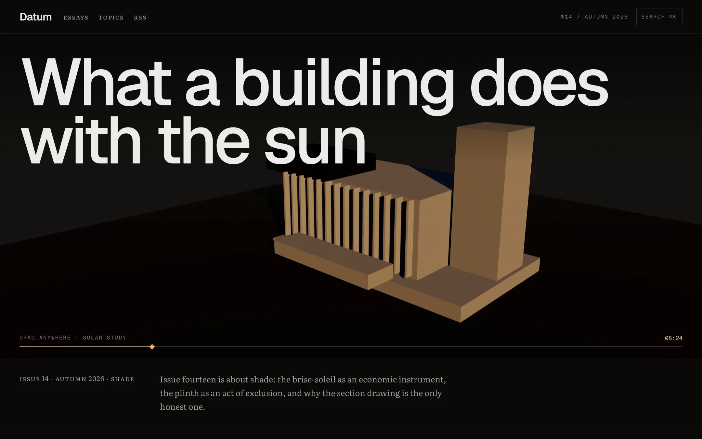
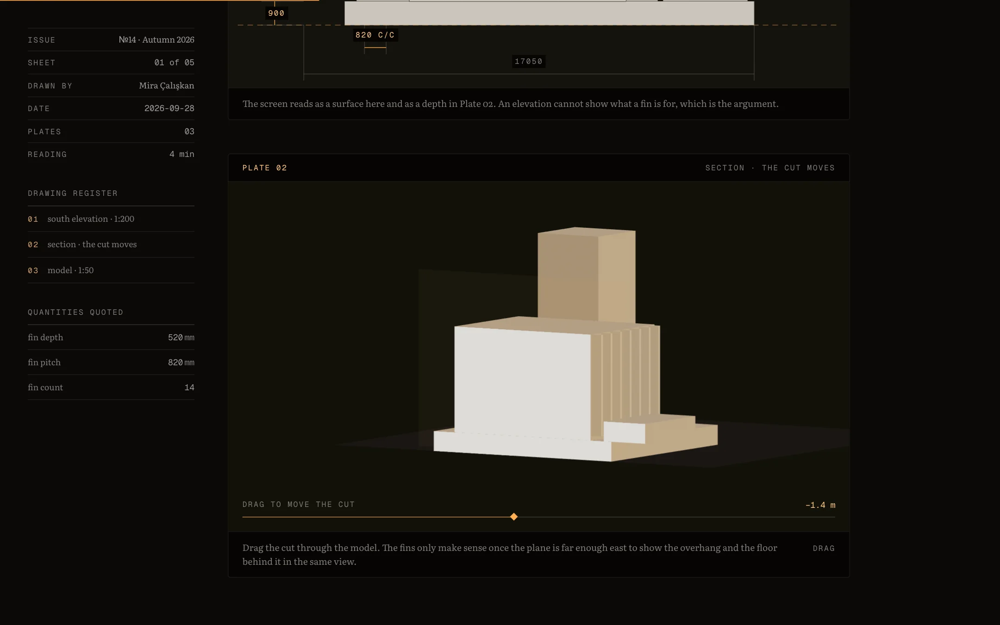
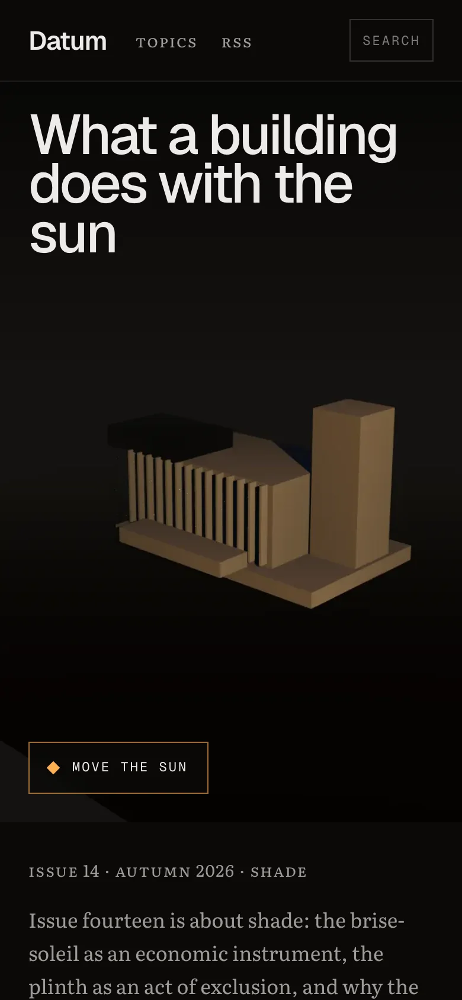
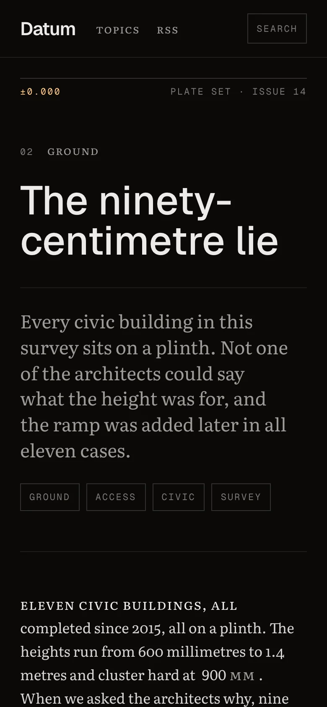
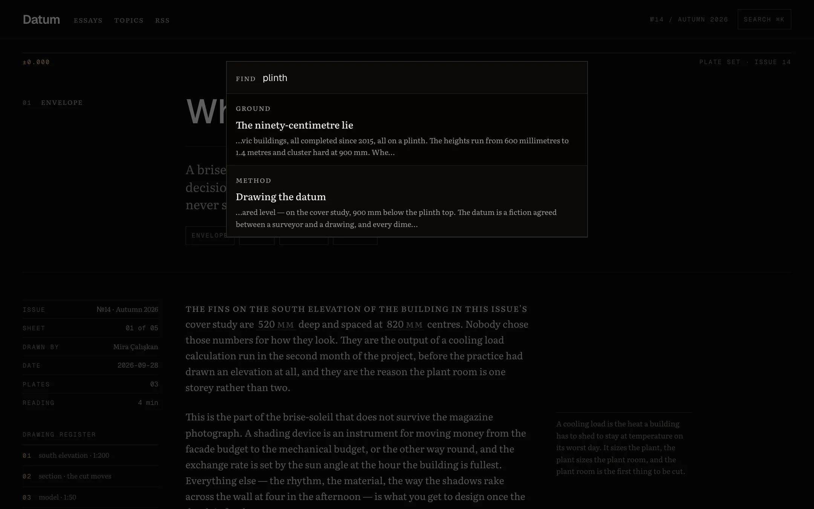

# Datum

An architecture journal where the drawings are live and the numbers are not typed — built as a real blog: MDX posts, topics, search, a feed and share cards.

**Live:** <https://datum-journal-62n.pages.dev>



## In three seconds

- **Drag the sun across the cover**, move the cutting plane through a section, re-base a level schedule, put the building on your desk in AR. Nine plates, every one drawn from the same model.
- **A blog a client can run:** posts are MDX files with front matter; ⌘K search over the full text, topics, related reading, RSS, sitemap and a generated share card per post.
- **Fast where it counts:** Lighthouse mobile 92 on the 3D cover and on all five articles, total blocking time 10–90 ms, accessibility 100 and axe 0 violations on every page.

---

## Challenge → solution → result

| The problem | What was built | Measured |
| --- | --- | --- |
| A WebGL cover kept a phone's main thread busy before the first tap | A poster rendered from the scene itself shows first; the live scene fades in over it on idle on a desktop and on request on a phone | Cover mobile score **54 → 92**, blocking time **1,570 → 10 ms** |
| Articles loaded three.js for plates far below the fold | WebGL plates mount within a screen of the reader; SVG plates still ship in the HTML | All five articles **92**, blocking time **20–90 ms** |
| Essays lived in a TypeScript array — only a developer could edit them | MDX with front matter; plates and quantities are tags, numbered and cross-referenced at build time; an unknown one fails the build | 5 posts, 4,200 words, migration proven lossless by a test before the old format was deleted |
| A journal with no way in but the cover | Topics, related posts, ⌘K / `/` search over a static index, RSS 2.0, sitemap, per-post Open Graph cards, a styled 404 | Every feature driven by a browser check on a phone and a desktop |

<p>
  
  
  
</p>



## The one idea

Every measured quantity is derived from a single array — the building, written as data in [`src/lib/massing.ts`](src/lib/massing.ts). The cover, the elevation, the section, the AR model, the dimension chains and **the numbers inside the prose** all read from it:

```mdx
{/* content/posts/what-the-fins-are-for.mdx */}
The fins on the south elevation are [[finDepth]] deep and spaced at [[finPitch]] centres.

<Plate kind="section">Drag the cut through the model.</Plate>
```

`[[finDepth]]` resolves at build time and throws on an unknown key, so a typo fails the build instead of shipping. The article once claimed the fins were 140 mm deep against a model that projects 520 — and it was wrong for exactly as long as it was a string.

## Things worth opening the code for

- **The posts pipeline** — [`src/lib/post-source.ts`](src/lib/post-source.ts) numbers plates, points the elevation at the section, marks each quantity's first mention for the margin schedule, and passes every attribute as a string: the compiler runs with JavaScript blocked, so a non-developer can edit a post safely.
- **Poster-first 3D** — [`src/components/three/CoverStage.tsx`](src/components/three/CoverStage.tsx), with posters rendered from the live canvas by [`scripts/cover-posters.mjs`](scripts/cover-posters.mjs). The live camera opens on the poster's exact frame, so the crossfade does not move.
- **The AR is generated, not exported** — [`scripts/build-ar.mjs`](scripts/build-ar.mjs) writes USDZ and GLB from the same array on every build, reproducibly (zip timestamps pinned). iOS opens native Quick Look, Android a Scene Viewer intent, a desktop a QR code drawn as SVG at build time.
- **The section is a section** — cut material is filled solid, the convention that tells a reader what was cut from what stands behind it.
- **The type is subset and measured** — Literata cut to 439 glyphs and 151 KB with real small caps and old-style figures, which Google's CSS API strips; [`qa/type.mjs`](qa/type.mjs) proves they load.

## Checks

`npm run check` runs typecheck, lint, 45 Vitest tests and the build. Six Playwright suites in [`qa/`](qa) drive the production build in a real browser:

- **`journal.mjs`** — search, topics, related reading, sign-up, feed, 404; and every article with every plate mounted shows no `undefined`, numbers its plates 1…n and points the elevation at the section.
- **`shot.mjs`** — every canvas painted and lit, deferred plates actually deferred and then mounted, no console errors, no overflow, **no request leaving the origin**.
- **`invisible.mjs`**, **`keyboard.mjs`**, **`ar.mjs`**, **`type.mjs`** — every drawn line completes, every control is reachable by Tab, the AR files and QR are valid, the type is the type it claims to be.

Each check was shown failing on the bug it was written for before it was trusted.

## Running it

Node 24 LTS.

```bash
npm install
npm run dev          # http://localhost:3300
npm run build        # prebuild regenerates the AR models and the QR
npm start            # serves the static export on :3300
npm run qa           # browser checks against that server
npm run posters      # re-render the cover posters from the live scene
npm run deploy       # build and publish to Cloudflare Pages
```

Posts live in [`content/posts`](content/posts). The newsletter form posts to `NEXT_PUBLIC_NEWSLETTER_URL` (any endpoint that accepts an `email` field); unset, it says sign-ups are closed and points to the feed.

## Stack

Next.js 16.4 App Router (`output: "export"`) · React 19.3 + React Compiler · MDX via next-mdx-remote 6 · Tailwind CSS v4 · three 0.186 / React Three Fiber 9.8 / drei · Vitest 5 · Playwright · Cloudflare Pages.

The building is fictional. The failure modes are not.
